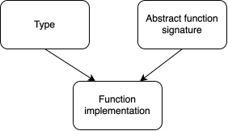

# Explaining composition in Haskell

There are two main forms of polymorphism modern programming languages use: _inheritance_ and _composition_. Haskell and its typeclasses sit firmly in the _composition_ category.

If you are already familiar with composition through languages such as Rust, Haskell works nearly identically (but with different names for the same terms).

## A note on composition vs inheritance
Composition in Haskell is actually quite straightforward. The main confusion for new readers typically comes from readers who have already learned inheritance through other programming languages and try to leverage that knowledge to more quickly understand composition. This confusion arises in two ways:
1. trying to mentally map _inheritance_ onto _composition_ rather than just learning _composition_ from scratch
2. the naming of the _composition_ terms that overlap with _inheritance_ terms, but mean something different.

Because these paradigms are quite different, attempts to understand one through the other will largely backfire. Therefore, we **strongly** recommend setting aside any prior knowledge of inheritance and try to understand composition from the beginning.

## The three horsemen of composition: types, typeclasses, and instances

Composition, at it's heart, is made up of three things:
1. types (called **types**)
2. collections of abstract function signatures (called **typeclasses**)
3. function implementations (called **instances**) that connect types (1.) and function definitions (2.)



Informally, these can be summarized as:
1. things
2. behaviors
3. a recipe of how things (1.) implement the behaviors (2.)

To make this concrete, we provide an example below

## Example


**Type:** `Bit`

Our trusty `Bit` type. We provide the source code definition of `Bit` below. Under the hood, `Bit` actually contains two values: 1. whether the bit is undefined or not and 2. the value of the bit.

```
data Bit =
  Bit { unsafeMask#      :: {-# unpack #-} !Word
      , unsafeToInteger# :: {-# unpack #-} !Word
      }
```

The details aren't super relevant to this topic, but we mention them here because the implementation informs how our code will check if a bit in undefined.

**Typeclass:** `Show`

`Show` is a class that defines the behavior of "given this type, turn it into a string". The `Show` class defines a `show` function, which does exactly that

```
class Show a where

    -- Functions provided by Show class
    show :: a -> String
    -- other function go here...
```

**Instance:** `Show Bit`

The instance connects `Bit` to `Show` by providing an implementation. Notice here, any `a`s in the typeclass definition are replaced by the concrete type `Bit`.

```
instance Show Bit where

  -- Implement show for Bit
  show (Bit 0 b) =
    case testBit b 0 of
      True  -> "1"
      False -> "0"
  show (Bit _ _) = "."
```

The code above uses [pattern matching](../chapter_01/pattern_match.md) to check if the undefinedMask value of the bit. If it's `0`, the function outputs the value of the bit. If the undefinedMask is `1`, the function outputs `.`.

We can then see the behavior below
```
>>> show high   -- Equivalent to show (Bit 0 1)
1
>>> show low    -- Equivalent to show (Bit 0 0)
0
>>> show (Bit 1 1)
.
>>> show (Bit 1 0)
.
>>> show (Bit 1 undefined)
.
```

**Putting it all together**

From the compiler's perspective, the resolution chain is:

- For this function applied to this type, is it 1. a standalone function or 2. part of a typeclass?
- If 2, can I find an instance (implementation) of this typeclass for this function somewhere? 
- If yes, use that instance. If no, throw a compilation error.

...that's it really.

## Saving ourselves some time when implementing typeclasses
The intutions we mention above will take you pretty far. In fact, if you just finished reading the last section, it's probably a good idea that you stop for now and read this section another time. Though composition is simple, it can take some getting used to. Otherwise, continue below.

In the example above, we simplified the source code a bit. We will paste the complete source code below, this time only removing some comments for clarity. The differences we will discuss are highlighted.

```
data Bit =
  Bit { unsafeMask#      :: {-# unpack #-} !Word
      , unsafeToInteger# :: {-# unpack #-} !Word
      }
  <!--hl-->deriving (Data, Generic)<!--/hl-->
```

```
class  Show a  where
    <!--hl-->{-# MINIMAL showsPrec | show #-}<!--/hl-->

    -- | Convert a value to a readable 'String'.
    showsPrec :: Int    -- ^ the operator precedence of the enclosing
                        -- context
              -> ShowS

    -- | A specialised variant of 'showsPrec', using precedence context
    -- zero, and returning an ordinary 'String'.
    show      :: a   -> String

    showList  :: [a] -> ShowS
    showsPrec _ x s = show x ++ s
    show x          = shows x ""
    showList ls   s = showList__ shows ls s
```

```
instance Show Bit where
  show (Bit 0 b) =
    case testBit b 0 of
      True  -> "1"
      False -> "0"
  show (Bit _ _) = "."
```
(this one is actually identical, hence no highlighting).

**Explaining `deriving ()`**

We often write data types that have self-explanatory typeclass implementations. For example, let's say we define a type `MyShape` which contains an x and y position:

```
data MyShape Int Int
  = Square Int Int
  | Circle Int Int
```

How should we implement the `Eq` (which defines `==`) typeclass for `MyShape`?

Well, we probably want to say

"If every piece of data inside them is equal, then they're equal. Otherwise, they're not."

Because this same logic is repeated for many other types, Haskell provides the ability for the user to let the compiler guess at a sensible default for the typeclass implementation. This feature is invoked by using the `deriving ()` keyword. The typeclasses to derive go inside the parentheses.

Of course, you can always implement an instance yourself rather than deriving it.

**Explaining `{-# MINIMAL #-}`**

You may have noticed that certain functions in typeclasses can be defined in terms of other functions in the same typeclass. For example for `Eq`, which defines two functions: `==` and `/=`.

```
class  Eq a  where
    {-# MINIMAL (==) | (/=) #-}

    (==), (/=)           :: a -> a -> Bool
```
_([source](https://hackage-content.haskell.org/package/ghc-internal-9.1401.0/docs/src/GHC.Internal.Classes.html#Eq))_

However, if one provides a `(==)` implementation for a type, the `(/=)` implementation can be derived by negating the output of `(==)` (since negation is well defined for `Bool`, the output type.) Inversely, if one provides `(/=)`, the implementation of `(==)` can be similarly derived.

Therefore, for these types of situations, typeclasses can declare a _minimal_ set of functions required to implement this typeclass, and the other functions can be inferred based on this minimal definition.

**Explaining superclasses**

This feature is not highlighted/present in the examples above, but we include it anyway.

Some typeclasses implementations only make sense if the type also implements another typeclass. For example, consider the `Ord` typeclass:

```
class  (Eq a) => Ord a  where
    compare              :: a -> a -> Ordering
    (<), (<=), (>), (>=) :: a -> a -> Bool
    max, min             :: a -> a -> a
    {-# MINIMAL compare | (<=) #-}
```
([source](https://hackage-content.haskell.org/package/ghc-internal-9.1401.0/docs/src/GHC.Internal.Classes.html#Ord))

`Ord` implements `(<)` and `(>)`, but also `(<=)` and `(>=)`. Therefore, it only makes sense for `Ord` to apply to a type if that type also implements `Eq`.

Put another way, the implementation of `Ord` could do one of two things: use the existing definition of `(==)` or implement its own definition of equality (implicitly or explicitly).

The pros and cons of each approach are
- Reuse `(==)`
    - Pros: Universal, consistent notion of what equality means for that type
    - Cons: Certain typeclasses require the type to implement other typeclasses
- Implement own definition
    - Pros: Each typeclass can stand alone
    - Cons: Behavior can be inconsistent between implementations; requires re-implementing a potentially already defined function

The Haskell language has decided on the first approach. Therefore, if a `typeclass b` requires the type to also implement `typeclass a`, then we say `typeclass a` is a **superclass** of `typeclass b`.

We already saw how to define superclasses in the example above. It has the syntax

```
class (MySuperClass a, MyOtherSuperClass a, ...) => MyClass a where
```

and this lets us use the functions provided by our super classes inside our typeclass instance implementations.